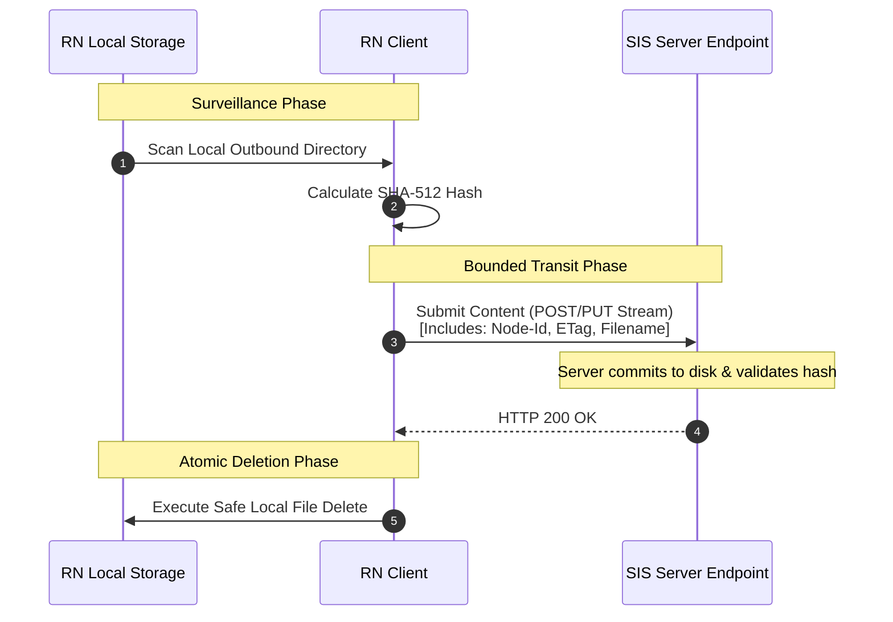
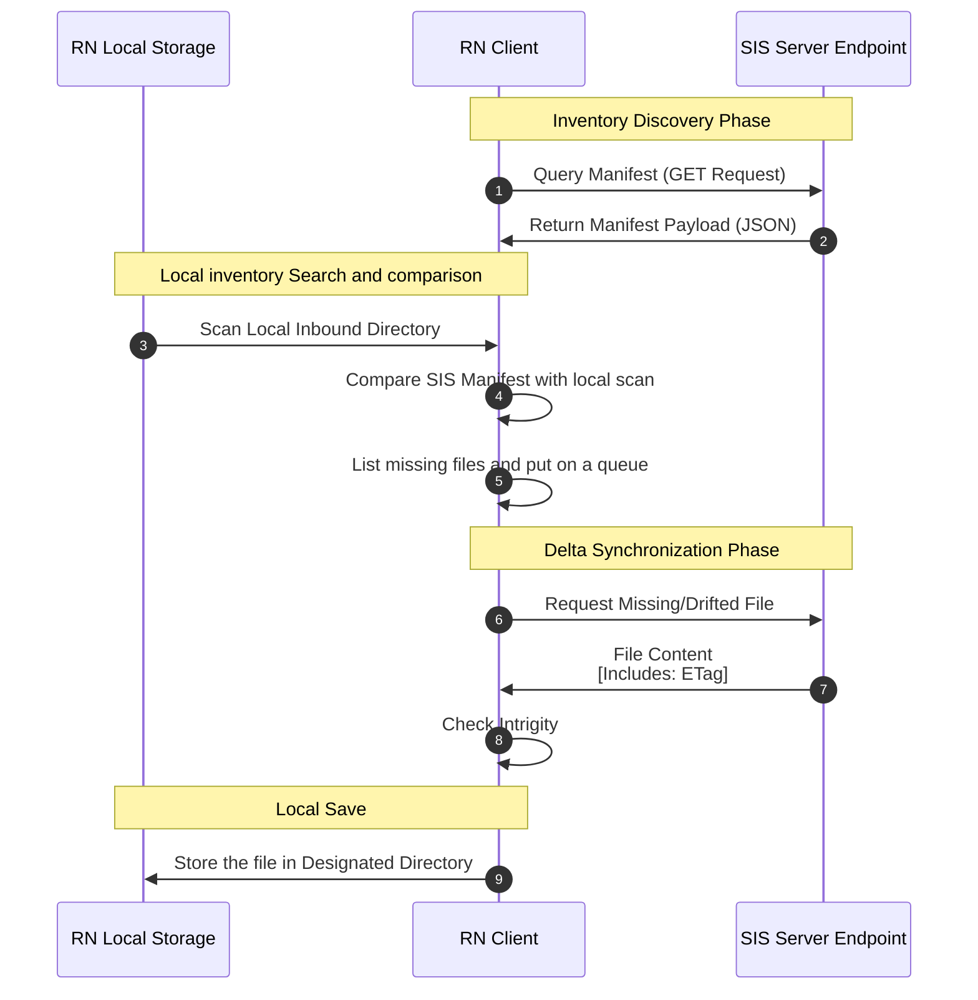

# OpenDTS Architecture
## Remote Node to Secure Infrastructure Server Interface Control Document

* **Version No:** 0
* **Date:** Oct 05, 2026
* **Document Status:** Draft Baseline
* **Licensing:** Apache License 2.0

---

### Revision History

| Version No. | Date | Change Details | Author | Remarks |
| :--- | :--- | :--- | :--- | :--- |
| 0 | 10/05/2026 | Initial Release  | Shouvik M |  |
| | | | | |

---

## 1. Introduction

### 1.1 Scope and Purpose of the Document
This document defines the high-integrity control interfaces and data exchange formats of the OpenDTS framework. Primarily, it establishes the communication boundaries, sequence state logic, and manifest validation criteria between the RN and the SIS.

### 1.2 Acronyms and Definitions
* **OpenDTS:** Open Data Transfer System
* **RN:** Remote Node
* **SIS:** Secure Infrastructure Server

### 1.3 Reference Documents
* TODO Fill before release.

---
---

## 2. OpenDTS API Interface

### 2.1 Purpose
The purpose of the OpenDTS API Interface is to define a common, reusable, and framework-agnostic protocol that enables Remote Nodes (RNs) to reliably exchange data with the Secure Infrastructure Server (SIS). The framework is designed to remain generic and extensible, allowing its clean adoption across multiple distinct embedded deployment fields (such as automotive, aerospace, or industrial automation) in the future.

### 2.2 Scope
This document defines the scope of the OpenDTS API Interface by describing the control information, data formats, interfaces, data exchanges, and control mechanisms required to support integration between the RN and the SIS. The scope is limited to the RN-SIS interface required for data exchange and does not include implementation-specific details unless they are necessary to define the interface behavior.

### 2.3 Use Cases

The OpenDTS framework serves as a foundational, domain-agnostic data pipeline designed to fit a wide variety of deployment scenarios across industries such as aerospace, automotive, robotics, and industrial IoT. Because the system focuses strictly on high-integrity data movement and state synchronization, how developers choose to leverage the framework is entirely up to the needs of the project.

Prime examples of how this framework can be used include, but are not limited to, the following operational use cases: 

#### 2.3.1 Digital Twin Infrastructure Support
OpenDTS acts as the underlying edge-to-cloud infrastructure required to sustain live digital twin modeling. By continuously syncing operational parameters, sensor logs, and system states between physical Remote Nodes and cloud-side models, the framework provides the predictable data delivery necessary to maintain a real-time virtual replica of the asset.

#### 2.3.2 Asymmetric Multi-Stakeholder Data Collection (Outbound)
A physical edge node captures data from different internal sensors or subsystems owned by separate entities. The node isolates these data streams locally and securely routes them to separate infrastructure servers based on data ownership boundaries.

#### 2.3.3 Self-Healing Software and Configuration Orchestration (Inbound)
An embedded field unit operating on an intermittent or variable data-link checks its local file state against an authoritative server model. It automatically identifies missing or corrupted configuration files and downloads only the required deltas to achieve an exact state match.

### 2.4 System Description

#### 2.4.1 Remote Node (RN)
The Remote Node (RN) is the generic embedded-side client in the OpenDTS system. It represents an embedded device, controller, gateway, or software-enabled field unit that requires a controlled mechanism for exchanging files and associated metadata with the Secure Infrastructure Server (SIS). The RN hosts the OpenDTS client functionality and initiates communication with the configured SIS endpoint over the defined HTTPS interface. Its design is intended to remain independent of any specific hardware platform, operating system, or application domain so that the same interface can be adopted by different embedded projects.

The RN client application maintains absolute authority over local storage modification and execution state management, isolating internal application tasks from external network synchronization loops.

#### 2.4.2 Secure Infrastructure Server (SIS)
The Secure Infrastructure Server (SIS) is the server-side component of the OpenDTS system and provides the central communication and content-transfer services used by one or more Remote Nodes. It exposes the OpenDTS HTTPS APIs, receives requests initiated by RNs, and returns the corresponding content, metadata, transfer state, or operation result. The SIS provides a common server interface so that embedded clients can exchange data without depending on the implementation details of the underlying storage, hosting platform, or infrastructure environment.

The SIS architecture enforces strict logical boundaries between remote nodes, ensuring that connection states, directory metadata mappings, and transferred content payloads remain strictly isolated per unique node identifier (`X-Node-Id`).

### 2.5 Transfer Mechanism and Mapping Architecture

#### 2.5.1 Folder Mapping Principles
The baseline alignment of data between the edge (RN) and the cloud (SIS) is achieved through a strict, symmetrical directory structure. The architecture requires a direct, one-to-one logical mapping between the internal storage folders of the RN and the remote directory paths exposed by the targeted SIS.

To ensure human readability, simplify system auditing, and reduce configuration errors across different programming language implementations, it is heavily recommended that the physical folder on the RN and its partner directory folder on the SIS share the exact same string name.

#### 2.5.2 Inbound and Outbound Mode Definitions
Every mapped directory pair must be configured to run in an exclusive, single-direction operational mode. A folder path must function strictly as either an **Outbound** queue or an **Inbound** sync path.

This directional mutual exclusion is a safety-critical design requirement. By preventing a single directory from executing bidirectional transfers simultaneously, the framework eliminates file modification race conditions, locking resource conflicts, and conflicting directory states between the server and the client.

#### 2.5.3 Detailed Outbound Transfer Architecture (The Bounded Queue)
The File push from the RN to the SIS is termed as Outbound Transfer. The outbound transfer architecture operates as a bounded, zero-leak storage mechanism designed to prevent local file systems from exceeding their storage limits. This sequence follows a strict, state-driven lifecycle:

1. **Local Surveillance:** The RN client continuously monitors the locally designated outbound directories. Once a file is dropped in any of the designated outbound directories, it is assumed that the file is completed and no modification is allowed in the file further.
2. **Integrity Inception:** The moment the local application drops a completed file asset into any of these folders (designated outbound directories), the RN client hooks into the file and calculates its unique SHA-512 cryptographic hash string.
3. **Payload Streaming:** The client initiates a secure connection to the bound SIS endpoint, transmitting the file payload along with the unique node ID, filename, and the pre-computed hash value.
4. **The Bounded Storage Rule:** While the file stream is in transit over the network, the physical file must remain untouched in its local edge storage directory. The client is strictly prohibited from altering, moving, or deleting the file asset during this phase.
5. **Atomic Deletion:** The server receives the stream, commits the bytes to its storage volume, recalculates the SHA-512 hash to verify data transit integrity, and returns a definitive 200 OK API response. Only upon the explicit receipt of this successful API response code is the RN client permitted to trigger a local file erasure command. If the network drops or the server returns an error, the file remains locked in the edge queue, completely safe from premature deletion.

#### 2.5.4 Detailed Inbound Transfer Structure (The Mirroring Mechanism)
The File pull from the SIS to the RN is termed as Inbound Transfer. The inbound transfer architecture utilizes a deterministic mirroring mechanism designed to enforce a perfect configuration state on the edge (RN) and eliminate unauthorized or corrupted local files. The synchronization routine executes sequentially through three distinct phases:

1. **The Inventory Discovery Phase:** The RN contacts the specific SIS endpoint mapped to the inbound directory. The server responds by serving an authoritative directory manifest. This payload contains a flat array of all valid filenames, precise file sizes, their last modification timestamp and their official server-side SHA-512 cryptographic hashes.
2. **The Delta Synchronization Phase:** The RN client library parses the server's manifest line-by-line and cross-references it with its physical disk. A file is automatically marked for retrieval if it hits any of the following three conditions:
    * The file is entirely missing from the Remote Node's local folder.
    * The file exists locally, but a local recalculation of the SHA-512 hash reveals a data drift compared to the server's authoritative hash.
3. **The Orphan Pruning Phase:** Once all valid files from the server manifest are downloaded and verified locally via SHA-512 checks, the RN client inspects the local directory for any extra files. If an asset is found locally at RN storage that was completely absent from the SIS's authoritative manifest, it is classified as an "orphan." The RN client immediately executes a permanent deletion command on these unlisted items, ensuring the edge folder perfectly mirrors the state of the Secure Infrastructure Server.
  

TODO Mirror Function

#### 2.5.5	Node-to-Server Mapping Concurrency (N:M Topology)
The OpenDTS framework is explicitly designed to handle complex, multi-stakeholder industrial environments by enforcing a flexible, many-to-many (N:M) network topology. Within this ecosystem, a single Remote Node (RN) is capable of being mapped to several independent Secure Infrastructure Servers (SIS) simultaneously. This granularity allows the edge node to route data payloads to different external entities based on data ownership and sovereignty constraints.

Conversely, each Secure Infrastructure Server is designed as a highly concurrent gateway capable of managing data streams from multiple Remote Nodes concurrently. The SIS isolates each connecting node into its own dedicated master environment using the node’s unique global identity parameter, ensuring total isolation between different field assets.

TODO: Mapping Diagram

---
---

## 3. Interface Security and Cryptography
.

---
---

## 4. RN Configurations
.

---
---

## 5. SIS Configurations
.

---
---

## 6.	RN-SIS Interactions Service

